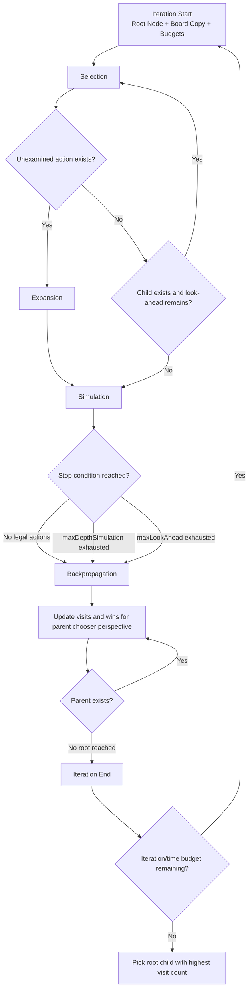

# UCT / MCTS Engine – Oware / Ouril

This document describes the AI engine implemented in the Oware / Ouril
project:

- `js/uct/uct.js`
- `js/uct/uctnode.js`
- `js/controller.js` (AI move budgets)

It reflects the current JavaScript implementation.

For broader system structure and module interactions, see
[software_architecture.md](software_architecture.md).

---

## 1. Engine Entry Point

The AI search entry point is:

```js
Uct.getActionInfo(board, maxIterations, maxTime, maxDepthSimulation, maxLookAhead)
```

Input contract:

- `board`: mutable adapter implementing
  - `getActions()`
  - `doAction(action)`
  - `copy()`
  - `getResult()`
  - `active`

Return value:

```js
{ action: number | null, info: string }
```

Behavior:

- no legal bowl to pick up from -> `action: null`
- exactly one legal bowl -> immediate return of that bowl
- otherwise run UCT search and return the root child with the highest
  visit count

---

## 2. Four UCT Phases in This Codebase



### Selection

From the root, repeatedly select the child with the maximum UCB score
until reaching a node that still has unexamined actions, has no children,
or the look-ahead budget is exhausted (`selectAndExpand` in `uct.js`).

### Expansion

If the current node has unexamined actions, pick one at random, apply it
to the simulation board (`Board#doAction`, i.e. a full pick-up/sow/harvest/
advance-turn cycle for one bowl), and create one new child.

### Simulation

Play random legal bowls from the expanded state (`simulate` in `uct.js`)
until one of these happens:

- no legal actions remain (game decided, or the active side has to pass
  under Ouril's extra-turn rule and even that yields no action)
- `maxDepthSimulation` is exhausted
- `maxLookAhead` is exhausted

### Backpropagation

Propagate the final simulation result from leaf to root (`backpropagate`),
updating `visits` and `wins` at every ancestor.

Important implementation detail:

- Reward is accumulated from the perspective of the player who was active
  at that node (`UctNode.activePlayer`), so UCB stays coherent across
  alternating turns.
- `Board#getResult()` returns `[0, 1]` once south's score exceeds 24 and
  `[1, 0]` once north's score exceeds 24 (index 0 rewards north, index 1
  rewards south) - this reward-vector convention is inherited unchanged
  from the original implementation and is intentionally preserved as-is,
  since `UctNode.update` and `Board.getResult` are always used together
  consistently.

---

## 3. UCB Formula Used

Selection in `UctNode.selectChild()` uses:

$$
UCB = \frac{wins}{visits} + \sqrt{\frac{2\ln(parentVisits)}{childVisits}}
$$

where:

- exploitation: $wins / visits$
- exploration bonus: $\sqrt{2\ln(N)/n}$

Notes:

- The exploration constant is effectively fixed at $\sqrt{2}$ (hardcoded
  in the formula above).
- This implementation does not expose the exploration constant as a
  runtime parameter.
- `selectChild()` and `mostVisitedChild()` both return `null` when there
  are no children yet, instead of throwing, matching the tolerant behavior
  of the original implementation.

---

## 4. Parameter Deep Dive

`Uct.getActionInfo(...)` parameters control breadth, depth, and
responsiveness.

### `maxIterations`

The maximum number of search loops the AI is allowed to run. A higher
value usually plays better because more possibilities were tested; a lower
value reacts faster but can miss strong moves. This is a hard ceiling, not
a promise - the search can still stop earlier once `maxTime` is reached.

### `maxTime` (ms)

The wall-clock time limit in milliseconds. This is the main control for
how long the human player waits before the AI moves. Time is checked in
batches of 50 iterations, so the search can stop slightly after the exact
target value.

### `maxDepthSimulation`

How many random future moves are played during the simulation phase of one
rollout. A larger value lets each rollout capture richer outcomes but
makes each rollout more expensive; a smaller value allows more rollouts in
the same time budget but each is shorter and noisier.

### `maxLookAhead`

A second depth limit applying to the total path length of one iteration,
covering both the selection steps and the simulation steps. It guards
against very long single iterations; if set too low it can cut off
tactical lines even when `maxDepthSimulation` is high.

---

## 5. Current AI Move Budgets

`js/controller.js` uses two fixed budgets (no per-side difficulty levels or
device profile are exposed in this implementation):

```js
const AI_MOVE_BUDGET    = { maxIterations: 300000, maxTime: 5000, maxDepthSimulation: 50, maxLookAhead: 70 };
const AI_OPENING_BUDGET = { maxIterations:  60000, maxTime: 3000, maxDepthSimulation: 50, maxLookAhead: 70 };
```

- `AI_OPENING_BUDGET` is used only for the very first AI move of a game
  started with the AI playing south.
- `AI_MOVE_BUDGET` is used for every AI move requested afterward
  (`action_by_ai` requests), regardless of which side is active.

Tuple order equivalent: `[maxIterations, maxTime, maxDepthSimulation, maxLookAhead]`.

---

## 6. Validation and Regression Coverage

Current tests in `src/tests/unit/uct.test.js` and
`src/tests/unit/uctnode.test.js` validate:

- immediate return behavior for zero and exactly one legal action
- a full Monte-Carlo search returning a legal action among several, for
  both generous and tight time budgets
- node bookkeeping: child creation/removal from the unexamined list,
  UCB-based child selection, visit/win accumulation, and the
  most-visited-child tie-break behavior, including the empty-children edge
  case

---

## 7. Future Improvement Options

1. Expose the exploration constant as a configurable parameter.
2. Add per-side difficulty levels and/or a device-performance profile,
   similar to budget tables used in other MCTS-based board game
   implementations by this author.
3. Add a transposition table keyed by board hash to reduce repeated work
   across iterations.
4. Add an adaptive budget policy based on move number and remaining legal
   actions.
