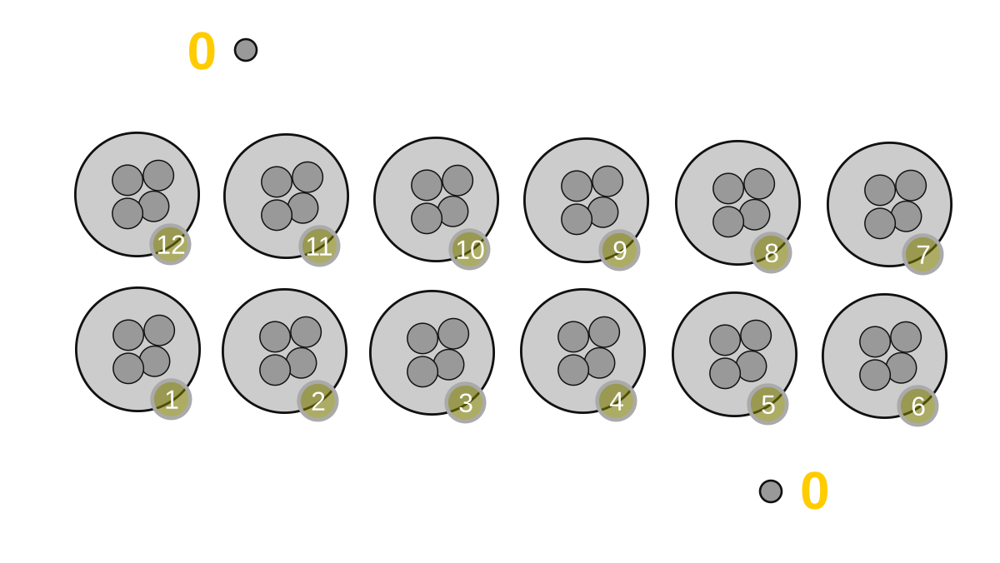
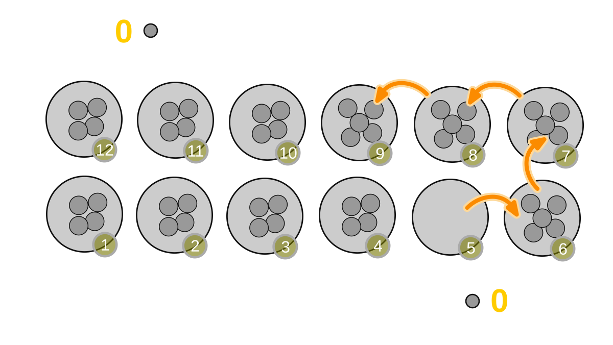
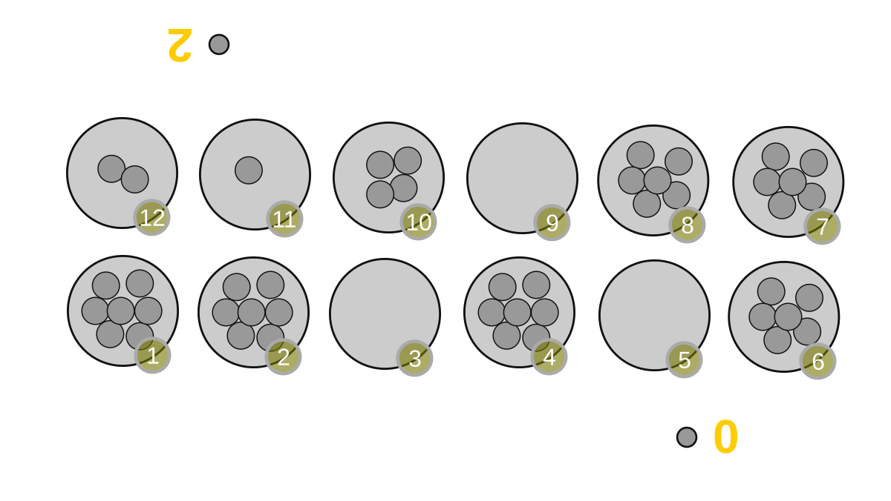
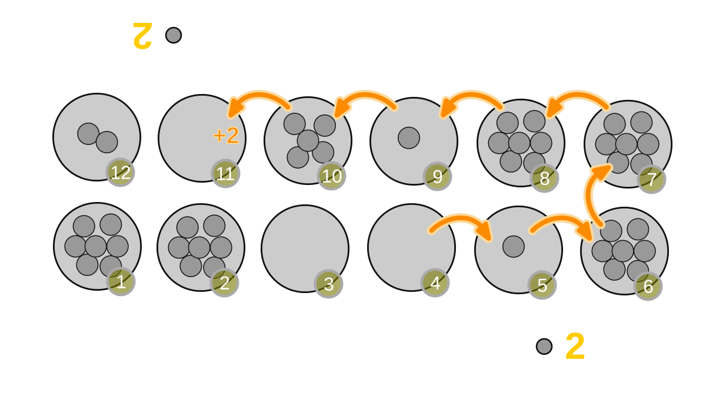
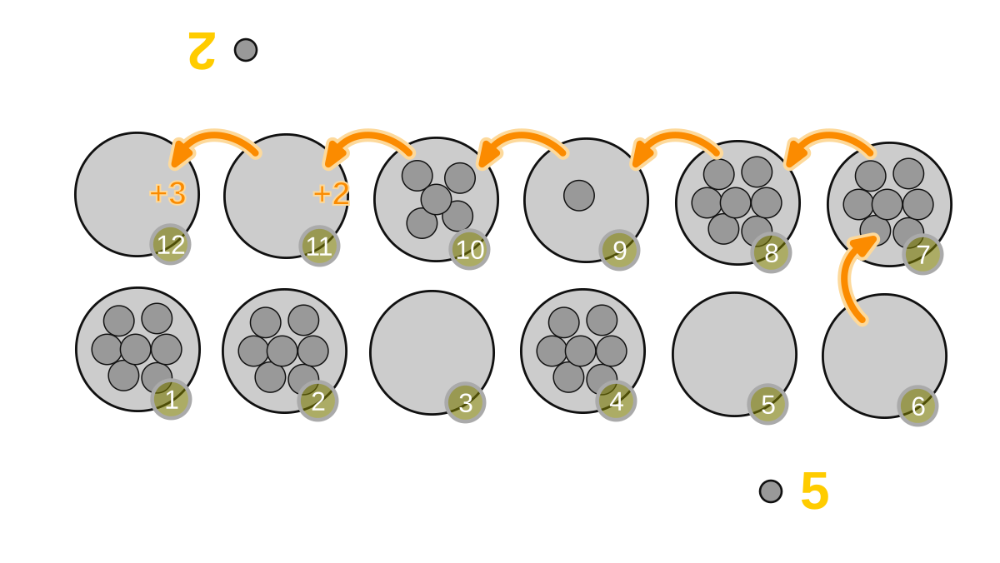
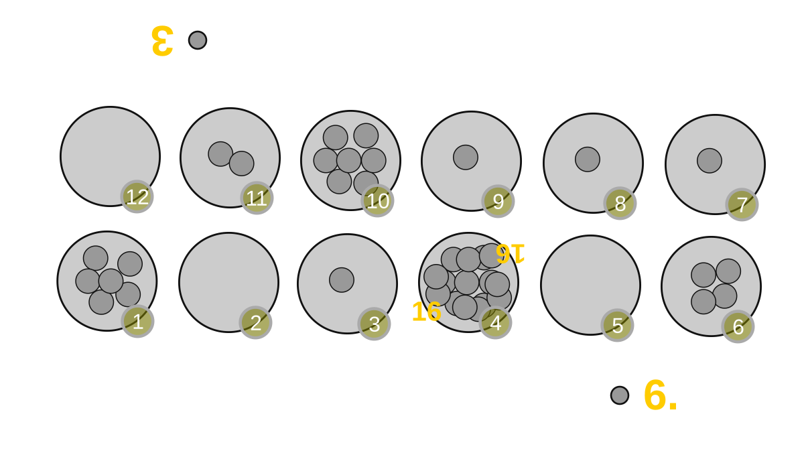
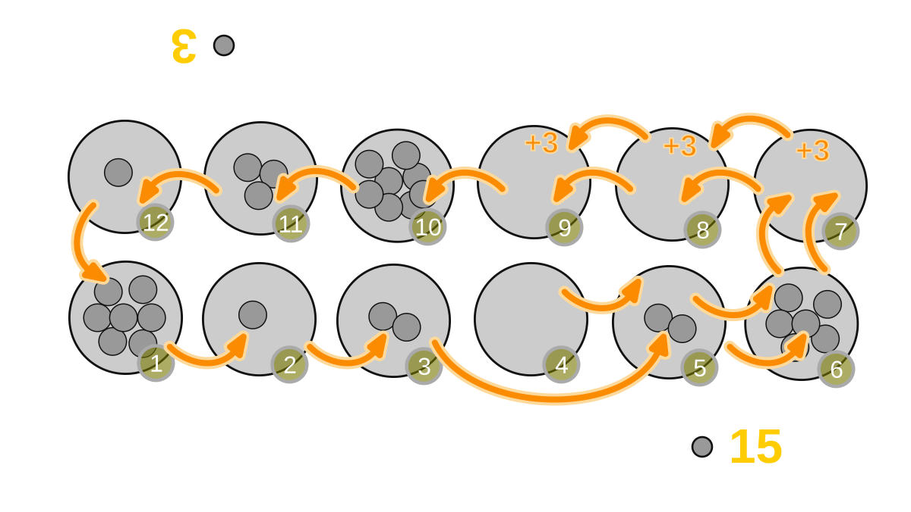

# Oware und Ouril spielen

> Diese Anleitung erklärt, wie man **Oware** und **Ouril** auf einem
> echten, physischen Spielbrett mit echten Samen (oder Perlen, Steinchen,
> Bohnen - beliebigen kleinen Spielsteinen) aufbaut und spielt. Es wird
> kein Computer, keine App und kein elektronisches Gerät benötigt.
>
> Oware und Ouril gehören zur großen Familie der Mancala-Spiele (auch
> Manqala oder Mankala geschrieben), die manchmal auch "Sähspiele" genannt
> werden. Am Zug nimmt man alle Spielsteine aus einer Mulde und verteilt
> ("sät") sie einzeln in die folgenden Mulden. Die folgenden Regeln
> erklären genau, wie das Aufnehmen, Säen und Punkten ("Ernten")
> funktioniert, sowie die wenigen besonderen Situationen, die dabei
> auftreten können.
>
> Oware ist das traditionelle Spiel, wie es in Ghana und anderen Teilen
> Westafrikas gespielt wird. Ouril ist die eng verwandte Variante, die in
> der Republik Kap Verde gespielt wird. Beide Spiele teilen sich fast alle
> Regeln; die Unterschiede werden ausdrücklich in
> [Ouril stattdessen spielen](#ouril-stattdessen-spielen) genannt.

## Was man braucht

- Ein Spielbrett mit **12 Mulden** (auch Gruben, Löcher, Häuser oder Trous
  genannt), angeordnet in **2 Reihen zu je 6 Mulden**, die sich
  gegenüberliegen - eine Reihe pro Spieler. Ohne Spielbrett kann man
  ebenso 12 kleine Löcher in derselben 2-mal-6-Anordnung zeichnen oder
  graben, zum Beispiel im Sand.
- **48 kleine Spielsteine**, alle von derselben Art - traditionell
  *Bonduc*-Samen (Nickernüsse), aber gewöhnliche Bohnen, Samen, kleine
  Steinchen, Perlen oder Muscheln funktionieren ebenso gut.
- **Zwei Spieler**, die sich gegenübersitzen, wobei jedem Spieler die
  nächstgelegene Reihe von 6 Mulden gehört.

Zur Orientierung nummeriert man die Mulden von 1 bis 12 im Kreis, gegen
den Uhrzeigersinn, beginnend bei der Mulde, die der linken Hand am
nächsten liegt (dies entspricht den folgenden Beispielen und Abbildungen).
Die eigene Reihe des einen Spielers sind die Mulden 1 bis 6, die eigene
Reihe des anderen Spielers sind die Mulden 7 bis 12.

*Ausgangsstellung: 12 Mulden, 4 Samen in jeder Mulde. Ein Spieler beginnt
seine Züge in der mit 1 bis 6 nummerierten Reihe, der andere Spieler
beginnt seine Züge in der mit 7 bis 12 nummerierten Reihe.*

## Das Spielbrett aufbauen

1. Das Spielbrett so zwischen die beiden Spieler legen, dass jeder Spieler
   eine volle Reihe von 6 Mulden direkt vor sich hat.
2. Genau **4 Samen in jede der 12 Mulden** legen. Das sind insgesamt 48
   Samen, von denen noch keiner gepunktet wurde.
3. Vereinbaren, wer beginnt. Für beide Reihen die oben erklärte
   Nummerierung verwenden (beginnend bei der Mulde, die der linken Hand
   am nächsten liegt); die Sä-Richtung verläuft immer **gegen den
   Uhrzeigersinn** rund um das gesamte Brett.
4. Zwei kleine Ablagen (eine Untertasse, eine hohle Hand oder einfach zwei
   getrennte kleine Haufen) neben dem Brett bereithalten - eine pro
   Spieler - um die geernteten (gepunkteten) Samen jedes Spielers
   aufzunehmen.

## Oware spielen

### Ziel des Spiels

Mehr Samen als der Gegner zu **ernten**, indem man sie im Laufe des
Spiels vom Brett nimmt. Die geernteten Samen bleiben für den Rest des
Spiels aus dem Spielgeschehen und zählen als Punktestand.

### Ablauf eines Zuges

Die Spieler wechseln sich mit ihren Zügen ab. Jeder Zug besteht aus drei
Teilen, immer in dieser Reihenfolge:

1. **Aufnehmen** der Samen aus einer eigenen Mulde.
2. **Säen**, ein Samen nach dem anderen, in die folgenden Mulden.
3. **Ernten**, falls die Stellung am Ende des Säens dies erlaubt.

### Schritt 1 - Aufnehmen

Am eigenen Zug eine beliebige, nicht leere Mulde in der eigenen Reihe
auswählen. **Alle** darin enthaltenen Samen aufnehmen und die Mulde leer
zurücklassen. Man darf jede der eigenen nicht leeren Mulden wählen; es
gibt keine Verpflichtung, eine bestimmte zu wählen (siehe
[Ouril](#ouril-stattdessen-spielen) für die eine Ausnahme von dieser
Regel).

### Schritt 2 - Säen

Beginnend bei der Mulde unmittelbar neben der geleerten Mulde (in
Richtung gegen den Uhrzeigersinn), **einen Samen in jede Mulde** legen, an
der man vorbeikommt, eine Mulde nach der anderen, rund um das Brett, für
so viele Samen, wie man aufgenommen hat. Bei Mulde 12 angekommen, geht es
bei Mulde 1 weiter.

Das Säen setzt sich immer auch in der Reihe des Gegners fort, nicht nur in
der eigenen Reihe - beim Säen ist man nicht auf die eigenen Mulden
beschränkt, das gilt nur für das Aufnehmen.

*Beispiel: Aus der Ausgangsstellung nimmt ein Spieler alle 4 Samen aus
Mulde 5 auf und sät je einen Samen in die Mulden 6, 7, 8 und 9. Der Zug
endet mit dem letzten Samen, der in Mulde 9 gesät wird.*

### Schritt 3 - Ernten

Die letzte Mulde betrachten, in die ein Samen gesät wurde:

- Liegt diese Mulde in der **eigenen Reihe**, endet der Zug einfach - es
  wird nichts geerntet.
- Liegt diese Mulde in der **Reihe des Gegners** und enthält jetzt
  **genau 2 oder 3 Samen** (den zuletzt gesäten Samen mitgezählt), **erntet**
  man (nimmt und behält) alle Samen aus dieser Mulde.

Nach dem Ernten der letzten Mulde weiter rückwärts prüfen (in Richtung des
Uhrzeigersinns, also die Mulde, in die unmittelbar davor gesät wurde),
solange jede dieser Mulden:

- weiterhin in der **Reihe des Gegners** liegt, und
- weiterhin **genau 2 oder 3 Samen** enthält.

Jede solche Mulde der Reihe nach ernten. Aufhören, sobald man auf eine
Mulde trifft, die leer ist, nur 1 Samen enthält, 4 oder mehr Samen
enthält oder nicht mehr in der Reihe des Gegners liegt - selbst wenn eine
andere, nicht angrenzende Mulde des Gegners noch 2 oder 3 Samen enthält.
Nicht angrenzende 2er und 3er werden niemals geerntet.

*Beispielstellung: Der Gegner hat bereits 2 Punkte erzielt. Der aktive
Spieler kann Samen aus Mulde 1, Mulde 2, Mulde 4 oder Mulde 6 aufnehmen.
Nur die Aufnahme aus Mulde 4 oder Mulde 6 ermöglicht das Ernten, wie im
Folgenden gezeigt wird.*

*Nimmt man die 7 Samen aus Mulde 4 auf und sät sie, landet der letzte
Samen in Mulde 11, die dann 2 Samen enthält. Diese 2 Samen werden
geerntet. Der Punktestand des Spielers steigt um 2.*

*Nimmt man stattdessen die 6 Samen aus Mulde 6 auf, landet der letzte
Samen in Mulde 12, die dann 3 Samen enthält - geerntet. Bei der
Rückwärtsprüfung liegt Mulde 11 noch immer in der Reihe des Gegners und
enthält nun ebenfalls 2 Samen - ebenfalls geerntet. Mulde 10 enthält
weder 2 noch 3 Samen, also endet das Ernten dort. Der Punktestand des
Spielers steigt insgesamt um 5 Samen (3 + 2).*

### Sonderregel: Kroo (sehr volle Mulden)

Eine Mulde mit einer großen Anzahl an Samen (mehr als 11) wird **Kroo**
genannt. Nimmt man einen Kroo auf, hat man genug Samen, um einmal ganz um
das Brett herum zu säen und die eigene Startmulde erneut zu erreichen.
**Die eigene Startmulde jedes Mal überspringen, sobald das Säen sie
erreicht** - nicht in sie säen - und stattdessen mit der nächsten Mulde
fortfahren. Die Startmulde bleibt am Ende des Zuges deshalb leer.

*Mulde 4 ist ein Kroo mit 16 Samen.*

*Nimmt man die 16 Samen aus Mulde 4 auf und sät sie einmal rund um das
Brett, wobei Mulde 4 selbst beim Erreichen übersprungen wird, wird der
letzte Samen in Mulde 9 gesät. Die Mulden 9, 8 und 7 enthalten am Ende
alle 2 oder 3 Samen und werden zusammen für insgesamt 12 Samen geerntet.*

### Sonderregel: Der Grand Slam ist verboten

Würde ein Zug **jeden einzelnen Samen** in der Reihe des Gegners ernten
(sodass der Gegner nach der Ernte keinen einzigen Samen mehr hätte), ist
dieser Zug in Oware **verboten**. Ein Spieler, der einen solchen Zug
dennoch ausführt, **verliert das Spiel sofort**, selbst wenn dieser
Spieler dadurch die Mehrheit aller Samen erhalten hätte. Nach jeder Ernte
muss mindestens ein Samen irgendwo in der Reihe des Gegners übrig
bleiben.

Leert der Gegner hingegen *freiwillig* durch seine eigene Zugwahl seine
eigene Reihe vollständig, ist das vollkommen zulässig, und das Spiel geht
einfach weiter.

### Sonderregel: Dem Gegner muss eine Spielmöglichkeit gelassen werden

Ist die Reihe des Gegners zu Beginn des eigenen Zuges vollständig leer,
muss man, wenn irgend möglich, einen Zug wählen, der mindestens einen
Samen in die Reihe des Gegners sät, damit dieser bei seinem nächsten Zug
einen Samen zur Verfügung hat. Ist keiner der verfügbaren Züge dazu in der
Lage, endet das Spiel sofort: Die verbleibenden Samen auf dem Brett werden
von niemandem geerntet, und der Spieler mit dem zu diesem Zeitpunkt
höheren Punktestand gewinnt.

### Das Spiel im gegenseitigen Einvernehmen beenden

Beide Spieler können sich jederzeit darauf einigen, das Spiel zu beenden.
In diesem Fall erntet jeder Spieler alle noch in der eigenen Reihe
verbliebenen Samen. Wer den höheren Punktestand hat, gewinnt.

### Gewinnen

Der Spieler mit den meisten geernteten Samen gewinnt, wenn das Spiel
endet. Haben beide Spieler denselben Punktestand, endet das Spiel
unentschieden.

## Ouril stattdessen spielen

Ouril, gespielt in der Republik Kap Verde, verwendet dasselbe Spielbrett,
dieselben 48 Samen und denselben Ablauf aus Aufnehmen, Säen und Ernten wie
oben beschrieben, mit zwei Unterschieden.

### Einzelne Samen aufnehmen

Eine Mulde mit nur **1 Samen** darf man nur dann aufnehmen, wenn **keine
der anderen eigenen Mulden mehr als 1 Samen enthält**. Mit anderen
Worten: Solange noch eine eigene Mulde mit 2 oder mehr Samen zur
Verfügung steht, muss man diese wählen, statt eine Mulde mit nur einem
Samen zu wählen.

### Der Grand Slam ist unter Bedingungen erlaubt

Anders als in Oware ist das Ausführen eines Grand Slam (das Ernten
sämtlicher Samen aus der Reihe des Gegners) in Ouril nicht automatisch
verboten - allerdings sind damit Bedingungen verknüpft:

- Nach einem Grand Slam muss man sofort **einen weiteren Zug** machen (der
  Zug des Gegners wird übersprungen).
- Bei diesem zusätzlichen Zug muss ein Zug gewählt werden, der die Reihe
  des Gegners danach mit mindestens einem Samen zurücklässt, sofern ein
  solcher Zug verfügbar ist.
- Ist kein solcher Zug verfügbar, ernten beide Spieler die in ihrer
  eigenen Reihe verbliebenen Samen, und das Spiel endet dort.
- Als Ausnahme gilt: Verschafft der Grand Slam selbst bereits die Mehrheit
  aller Samen des Spiels, darf man das Spiel direkt mit diesem Grand Slam
  beenden - ein zusätzlicher Zug ist in diesem Fall nicht erforderlich.

Alles andere - Aufnehmen, Säen, Ernten, die Kroo-Regel, das Beenden des
Spiels im Einvernehmen und die Ermittlung eines Gewinners - funktioniert
genau wie in Oware.

## Kurzübersicht

| Schritt | Oware | Ouril |
| --- | --- | --- |
| Aufnehmen | Beliebige nicht leere eigene Mulde | Beliebige nicht leere eigene Mulde, eine Mulde mit nur 1 Samen jedoch nur, wenn keine andere eigene Mulde mehr als 1 Samen enthält |
| Säen | Ein Samen pro Mulde, gegen den Uhrzeigersinn, eigene Startmulde beim Umlauf überspringen (Kroo) | Gleich |
| Ernten | Mulde(n) des Gegners, die mit 2 oder 3 Samen enden, fortlaufend rückwärts | Gleich |
| Grand Slam | Verboten - führt sofort zum Spielverlust | Erlaubt, erzwingt aber einen zusätzlichen Zug (mit Bedingungen), außer er entscheidet das Spiel bereits direkt |
| Kein Samen für den Gegner verfügbar | Die Reihe des Gegners darf nicht geleert werden, solange eine Alternative besteht; sonst endet das Spiel und der höhere Punktestand gewinnt | Gleich |
| Beenden im Einvernehmen | Jeder Spieler erntet die eigene verbliebene Reihe; höherer Punktestand gewinnt | Gleich |

## Glossar

- **Mulde / Grube / Haus / Trou** - einer der 12 Behälter auf dem
  Spielbrett.
- **Samen / Spielstein / Token** - die Spielsteine, die gesät und geerntet
  werden; traditionell Bonduc-Samen (Nickernüsse).
- **Säen** - das Verteilen jeweils eines Samens pro Mulde beim Fortschreiten
  gegen den Uhrzeigersinn rund um das Brett.
- **Ernten / Punkten** - das Entnehmen von Samen aus einer Mulde und deren
  Hinzufügen zum eigenen Punktestand, weil die Säregeln dies zulassen.
- **Kroo** - eine Mulde mit so vielen Samen (mehr als 11), dass das Säen
  einmal ganz um das Brett herum und zurück zur Startmulde führt, die
  dann übersprungen wird.
- **Grand Slam** - ein Zug, der sämtliche Samen aus der Reihe des Gegners
  auf einmal ernten würde.
