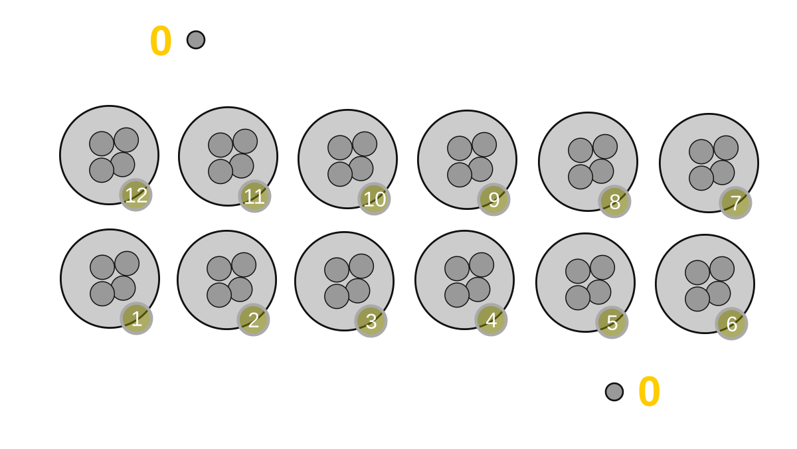
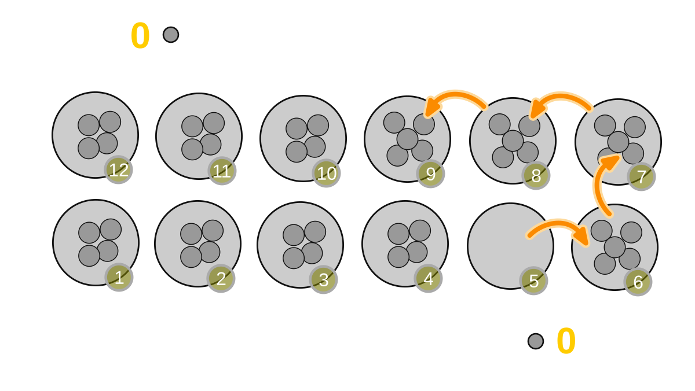
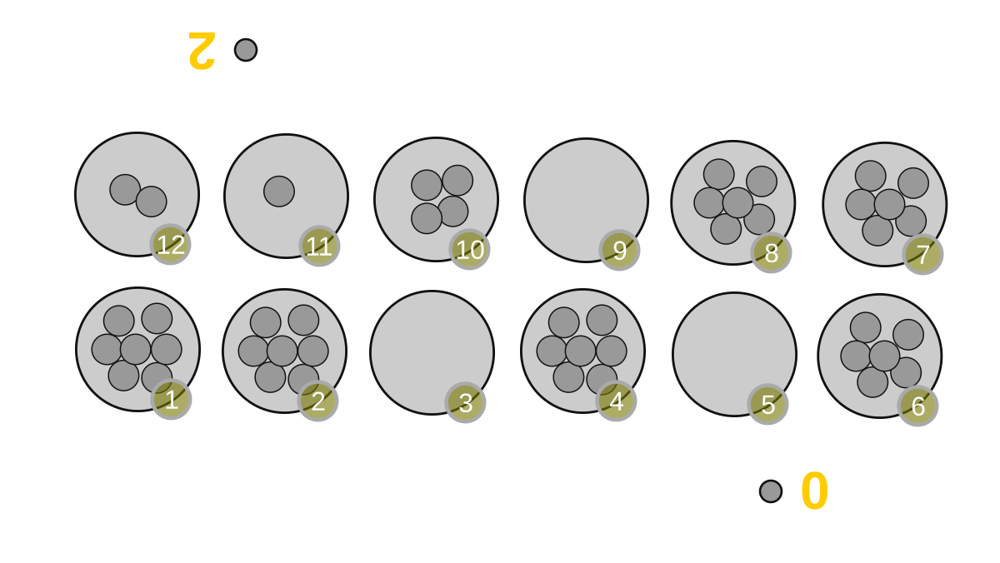
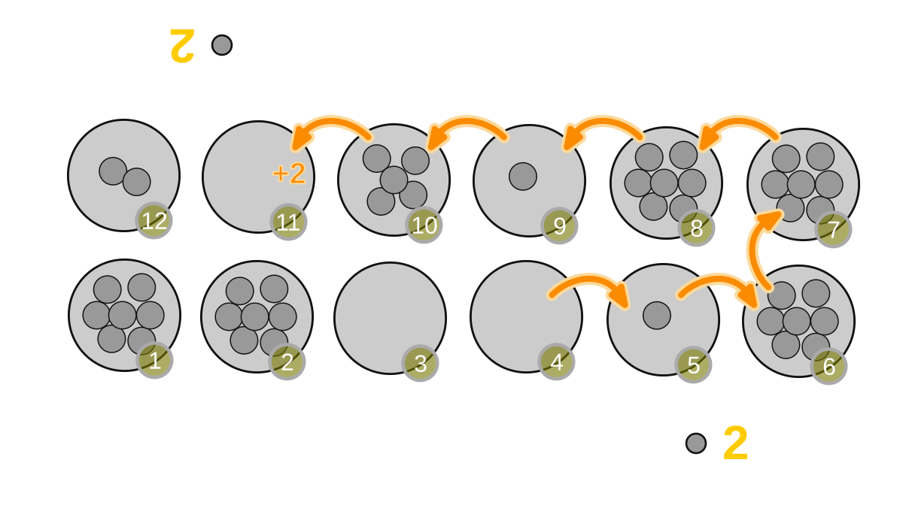
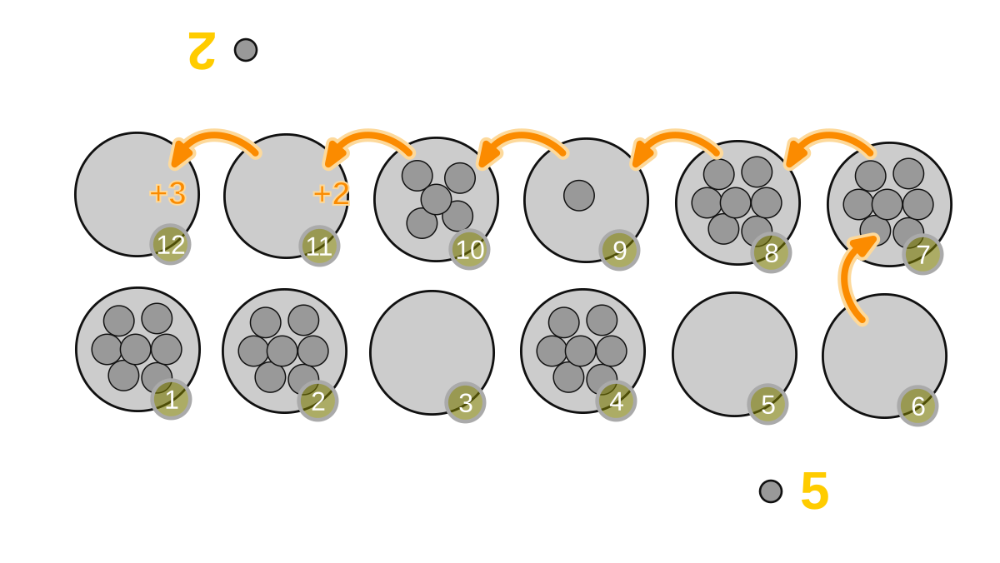
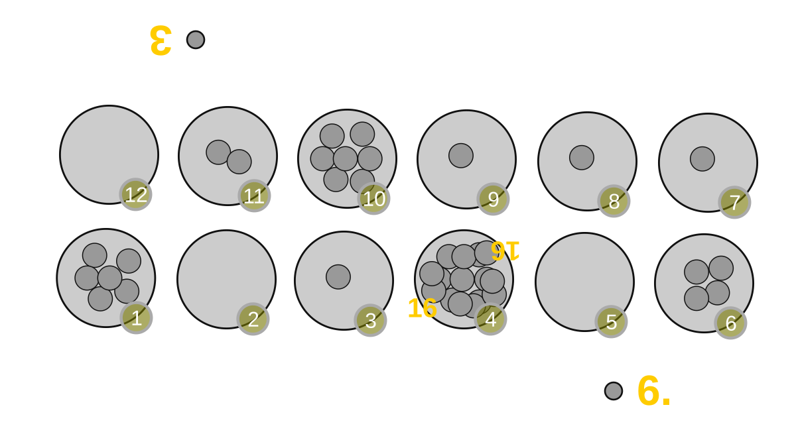
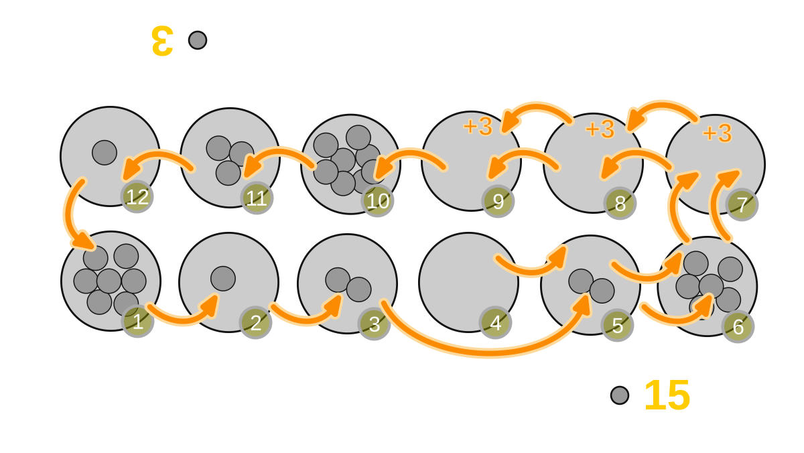

# How to Play Oware and Ouril

> This guide explains how to set up and play **Oware** and **Ouril** on a
> real, physical board with real seeds (or beads, stones, beans - any small
> counters you like). No computer, app or electronic device is needed.
>
> Oware and Ouril belong to the wide family of Mancala (also spelled
> Manqala or Mankala) games, sometimes called "sowing games". On your
> turn you pick up all the counters from one bowl and drop ("sow") them
> one by one into the following bowls. The rules below tell you exactly
> how picking up, sowing and scoring ("harvesting") work, plus the small
> number of special situations you will run into.
>
> Oware is the traditional game as played in Ghana and other parts of West
> Africa. Ouril is the closely related variant played in the Republic of
> Cabo Verde. The two games share almost all of their rules; the
> differences are called out explicitly in [Playing Ouril Instead](#playing-ouril-instead).

## What You Need

- A board with **12 bowls** (also called pits, holes, houses or trous),
  arranged in **2 rows of 6 bowls facing each other** - one row for each
  player. If you do not have a board, you can draw or dig 12 small holes
  in this same 2-by-6 arrangement, for example in sand.
- **48 small counters**, all of the same kind - traditionally *Bonduc*
  seeds (nickernuts), but ordinary beans, seeds, small stones, beads or
  shells work just as well.
- **Two players**, sitting on opposite sides of the board, one row of 6
  bowls closest to each player.

For reference, number the bowls 1 to 12 in a circle, counter-clockwise,
starting at the bowl closest to your left hand (this matches the
examples and pictures below). One player's own row is bowls 1-6, the
other player's own row is bowls 7-12.

*Initial board position: 12 bowls, 4 seeds in every bowl. One player
starts turns from any bowl in the row numbered 1 to 6, the other player
starts turns from any bowl in the row numbered 7 to 12.*

## Setting Up the Board

1. Place the board between the two players so that each player has one
   full row of 6 bowls directly in front of them.
2. Put exactly **4 seeds into every one of the 12 bowls**. That is 48
   seeds in total, none of them scored yet.
3. Agree who plays first. Use the numbering explained above (starting at
   the bowl closest to your left hand) for both rows; the sowing
   direction is always **counter-clockwise** around the whole board.
4. Keep two small side areas (a saucer, a cupped hand, or just two
   separate little piles) next to the board - one per player - to hold
   each player's harvested (scored) seeds.

## How to Play Oware

### Objective

Score more seeds than your opponent by **harvesting** them off the board
during play. The harvested seeds are kept out of play for the rest of
the game and count as your score.

### Turn Sequence

Players alternate turns. Every turn has three parts, always in this
order:

1. **Pick up** the seeds from one of your own bowls.
2. **Sow** them, one seed at a time, into the following bowls.
3. **Harvest**, if the position at the end of sowing allows it.

### Step 1 - Pick Up

On your turn, choose any one bowl in your own row that is not empty.
Pick up **all** the seeds it contains, and leave that bowl empty. You may
choose any of your non-empty bowls; there is no obligation to pick a
particular one (see [Ouril](#playing-ouril-instead) for the one
difference to this rule).

### Step 2 - Sow

Starting at the bowl immediately next to the one you emptied (in the
counter-clockwise direction), drop **one seed into each bowl** you pass,
one bowl at a time, continuing around the board for as many seeds as you
picked up. If you reach bowl 12, continue at bowl 1.

Sowing always continues into the opponent's row as well as your own - you
are not restricted to your own bowls while sowing, only while picking up.

*Example: from the starting position, a player picks up all 4 seeds from
bowl 5 and sows one seed each into bowls 6, 7, 8 and 9. The turn ends with
the last seed sown into bowl 9.*

### Step 3 - Harvest

Look at the very last bowl you sowed a seed into:

- If that bowl is in **your own row**, your turn simply ends - nothing is
  harvested.
- If that bowl is in your **opponent's row** and now contains **exactly 2
  or 3 seeds** (counting the one you just sowed), you **harvest** (take
  and keep) all the seeds from that bowl.

After harvesting the last bowl, keep checking backwards (in the clockwise
direction, i.e. the bowl you sowed into just before that one), as long as
each of those bowls is:

- still in your **opponent's row**, and
- still holding **exactly 2 or 3 seeds**.

Harvest each such bowl in turn. Stop as soon as you reach a bowl that is
empty, holds only 1 seed, holds 4 or more seeds, or has left the
opponent's row - even if some other, non-adjacent bowl of the opponent
still holds 2 or 3 seeds. Non-adjacent 2s and 3s are never harvested.

*Example board: the opponent has already scored 2 points. The active
player may pick up seeds from bowl 1, bowl 2, bowl 4 or bowl 6. Only
picking up bowl 4 or bowl 6 will let the player harvest, as shown next.*

*Picking up the 7 seeds from bowl 4 and sowing them lands the last seed
in bowl 11, which then holds 2 seeds. Those 2 seeds are harvested. The
player's score increases by 2.*

*Picking up the 6 seeds from bowl 6 instead lands the last seed in bowl
12, which then holds 3 seeds - harvested. Checking backwards, bowl 11 is
still in the opponent's row and now also holds 2 seeds - harvested too.
Bowl 10 holds neither 2 nor 3 seeds, so harvesting stops there. The
player's score increases by 5 seeds in total (3 + 2).*

### Special Rule: Kroo (Very Full Bowls)

A bowl holding a large number of seeds (more than 11) is called a
**Kroo**. When you pick up a Kroo, you will have enough seeds to sow all
the way around the board and reach your own starting bowl again. **Skip
your own starting bowl every time sowing reaches it** - do not sow into
it - and continue with the next bowl instead. Your starting bowl
therefore ends the turn empty.

*Bowl 4 is a Kroo, holding 16 seeds.*

*Picking up the 16 seeds in bowl 4 and sowing them all the way around,
skipping bowl 4 itself when reached, the last seed is sown into bowl 9.
Bowls 9, 8 and 7 all end up holding 2 or 3 seeds and are harvested
together for 12 seeds in total.*

### Special Rule: Grand Slam Is Forbidden

If a move would harvest **every single seed** currently on your
opponent's row (leaving them with no seeds at all after your harvest),
that move is **forbidden** in Oware. A player who nevertheless completes
such a move **loses the game immediately**, even if that player would
otherwise have collected the majority of all seeds. After every harvest,
at least one seed must remain somewhere on the opponent's row.

If, on the other hand, your opponent *voluntarily* empties their own row
completely by their own choice of move, that is perfectly legal and the
game simply continues.

### Special Rule: You Must Leave Your Opponent Able to Play

If your opponent's row is completely empty at the start of your turn,
you must, if at all possible, choose a move that sows at least one seed
into your opponent's row, so that they have a seed to play with on their
next turn. If none of your available moves can do this, the game ends
immediately: nobody harvests the remaining seeds on the board, and the
player with the higher score at that point wins.

### Ending the Game by Agreement

At any point, both players may agree to stop the game. When this
happens, each player harvests (scores) all seeds remaining on their own
row. Whoever has the higher score wins.

### Winning

The player with more harvested seeds when the game ends wins. If both
players end up with the same score, the game is a draw.

## Playing Ouril Instead

Ouril, played in the Republic of Cabo Verde, uses the same board, the
same 48 seeds, and the same pick-up/sow/harvest sequence described above,
with two differences.

### Picking Up Single Seeds

You may only pick up a bowl holding just **1 seed** if **none of your
other own bowls holds more than 1 seed**. In other words, if you still
have a bowl with 2 or more seeds available, you must choose one of those
instead of a single-seed bowl.

### Grand Slam Is Allowed, Under Conditions

Unlike in Oware, completing a Grand Slam (harvesting every seed from your
opponent's row) is not automatically forbidden in Ouril - but it comes
with strings attached:

- After completing a Grand Slam, you must **take another turn**
  immediately (your opponent's turn is skipped).
- On that extra turn, you must choose a move that leaves your opponent's
  row holding at least one seed afterwards, if any such move is
  available.
- If no such move is available, both players harvest the seeds remaining
  on their own rows, and the game ends there.
- As an exception, if the Grand Slam itself already gives you the
  majority of all the seeds in the game, you may end the game right there
  with that Grand Slam - no extra turn is required in that case.

Everything else - picking up, sowing, harvesting, the Kroo rule, ending
the game by agreement, and how a winner is decided - works exactly the
same as in Oware.

## Quick Reference

| Step | Oware | Ouril |
| --- | --- | --- |
| Pick up | Any non-empty own bowl | Any non-empty own bowl, but a single-seed bowl only if no other own bowl holds more than 1 seed |
| Sow | One seed per bowl, counter-clockwise, skip your starting bowl on wrap-around (Kroo) | Same |
| Harvest | Opponent's bowl(s) ending at 2 or 3 seeds, consecutively backwards | Same |
| Grand Slam | Forbidden - doing it loses the game instantly | Allowed, but forces an extra turn (with conditions), unless it already wins the game outright |
| No seed available for opponent | You must avoid emptying their row if any alternative move exists; otherwise the game ends and the higher score wins | Same |
| Ending by agreement | Each player harvests their own remaining row; higher score wins | Same |

## Glossary

- **Bowl / pit / house / trou** - one of the 12 containers on the board.
- **Seed / counter / token** - the pieces sown and harvested; traditionally
  Bonduc (nickernut) seeds.
- **Sowing** - dropping one seed per bowl while moving counter-clockwise
  around the board.
- **Harvesting / scoring** - removing seeds from a bowl and adding them to
  your own score, because the sowing rules allowed it.
- **Kroo** - a bowl holding so many seeds (more than 11) that sowing them
  wraps all the way around the board and back to the starting bowl, which
  is then skipped.
- **Grand Slam** - a move that would harvest every seed from the
  opponent's row in one turn.
