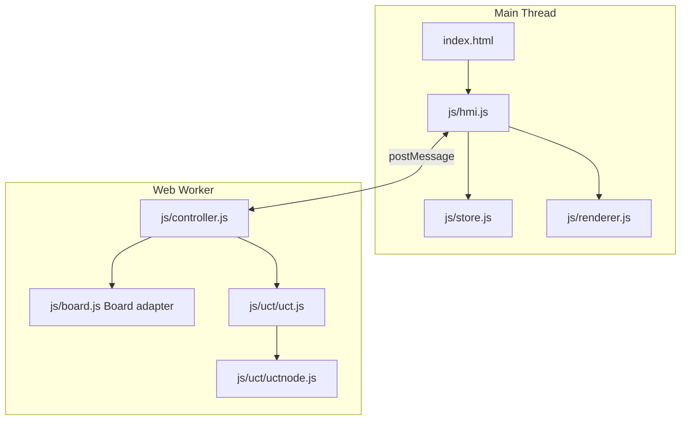

# Software Architecture – Oware / Ouril

> Copyright (c) 2016, 2026 Oliver Merkel. MIT License.

## 1. Overview

This project is a browser-only single-page application implementing the
Mancala games Oware and Ouril, with an optional Monte-Carlo Tree Search
(MCTS/UCT) AI player on either or both sides.
It uses modern ES modules, a Web Worker for game/AI control, and no runtime
framework or third-party UI library.

Core characteristics:

- ES module architecture with a single entry point (`js/hmi.js`).
- Pure board state transitions for deterministic testing (`js/board.js`).
- Worker-owned authoritative game state (`js/controller.js`).
- MCTS/UCT AI engine (`js/uct/`).
- Vanilla SVG renderer in the main thread (`js/renderer.js`, replaces the
  former Raphael-based rendering).
- Native `<details>`/`<summary>` collapsibles and a small custom side panel
  replace the former jQuery Mobile widgets; navigation and DOM interaction
  use plain `addEventListener`/DOM APIs instead of jQuery.
- Vitest unit tests and Playwright E2E tests.

For detailed UCT/MCTS internals and search-budget behavior, see
[engine_mcts_ucb.md](engine_mcts_ucb.md). For the module-by-module list of
functional and non-functional requirements and the tests that verify
them, see [requirements.md](requirements.md).

## 2. High-Level Architecture



## 3. Runtime Data Flow

1. The main thread sends `start`, `restart`, `move`, `action_by_ai`, or
   `sync` requests to the worker, always including the current form
   settings (players, rules, sowing speed).
2. The worker updates board state and posts `redraw`, `redraw_sowing`,
   `human_to_move`, or `ai_to_move` messages back, each carrying a plain
   (structured-clone-friendly) board state snapshot.
3. `hmi.js` maps worker messages to store actions.
4. The store notifies subscribers, which re-render the SVG board and apply
   view/panel/header DOM updates.

Main move loop:

- A human clicks a bowl; the click is only forwarded to the worker while
  the store's phase is `human_turn` (no client-side legal-move
  computation - the worker is the single source of truth for legality).
- The worker validates the move; illegal clicks are silently ignored and
  simply redraw the unchanged board (matches the original application's
  behavior - no legal-move highlighting).
- On a legal move, the worker picks up seeds and sows them one at a time,
  posting `redraw_sowing` before each single-seed placement (animated at
  `settings.sowingSpeed` milliseconds per step), then applies harvesting
  and turn advancement and posts `human_to_move` or `ai_to_move`.

UI navigation loop:

- Store updates trigger `applyView`/`applyPanelOpen`/`applyHeaderTitle`/
  `applyPlayerBadge` in `hmi.js`, toggling the `hidden` attribute on the
  page marked with the matching `data-view`, and toggling the `.open`
  class on the side panel.
- Exactly one of the game board (`data-view="game"`) or a subpage
  (`rules`/`options`/`about`) is visible at any time; showing a subpage
  fully hides the game board and vice versa.
- The header title reflects the selected rule set (`Oware` or `Ouril`).
- A badge on the right of the title bar shows the currently active
  player's configured kind and side: a Human/AI icon (🧑/🤖) followed by
  ▼ for south or ▲ for north, updated on every board snapshot from the
  worker (so it reflects the new active player right after each
  completed move). It stays hidden until the first board snapshot
  arrives.

## 4. Module Responsibilities

### `js/common.js`

Shared constants:

- `BOWLS_TOTAL = 12`, `SEEDS_PER_BOWL = 4`
- `SOUTH = 0`, `NORTH = 1`, `NO_BOWL = -1`
- `SOUTH_ROW = [0..5]`, `NORTH_ROW = [6..11]`
- `RULES = { OWARE, OURIL }`, `PLAYERS = { HUMAN, AI }`

### `js/board.js`

Pure Oware/Ouril state transitions plus a thin mutable adapter class for
the UCT engine and the worker controller.

State shape:

```js
{
  active: 0 | 1,           // 0 = south, 1 = north
  bowls: number[12],       // seed counts, south row 0-5, north row 6-11
  pickedUp: number,        // seeds still to be sown this turn
  initialBowl: number,     // bowl picked up from this turn (Kroo skip target)
  latestSown: number,      // last bowl a seed was sown into
  nextSowing: number,      // next bowl to sow into
  score: [number, number], // harvested seeds per player
  rules: 'Oware' | 'Ouril'
}
```

Key exports:

- `createBoard(rules)`, `setRules(board, rules)`
- `pickUp(board, bowl)`, `hasPickedUp(board)`, `sowOnce(board)` - single
  sowing step, used for the animated sowing sequence
- `harvest(board)`, `advanceTurn(board)`, `examineResult(board)` - scoring
  and turn-advancement rules
- `doAction(board, bowl)` - full pick-up/sow/harvest/advance in one call,
  used by the UCT search
- `getActions(board)` - legal bowls for the active player
- `getResult(board)` - UCT reward vector once a player's score exceeds 24
- `Board` mutable adapter (`pickUp`, `sow`, `hasPickedUp`, `examineResult`,
  `doAction`, `getActions`, `getResult`, `copy`, `setup`, `setRules`, plus
  `active`/`bowls`/`score`/`pickedUp`/`rules`/`state` getters). The `state`
  getter exposes the plain, structured-clone-safe snapshot posted across
  the worker boundary (an instance with only private fields would not
  survive `postMessage`).

Rule differences encoded in `getActions`/`advanceTurn`:

- Under `Oware`, any non-empty own bowl is a legal pick-up, and the turn
  always passes to the other player afterward.
- Under `Ouril`, a bowl holding a single seed may only be picked up when no
  other own bowl holds more than one seed, and a player who ends their turn
  with no legal action for themselves plays again instead of passing.

The Kroo rule (skipping the bowl a turn started from on wrap-around) is
implemented in the internal `nextBowlIndex` helper used by `pickUp` and
`sowOnce`.

### `js/renderer.js`

Vanilla SVG board renderer (12 bowls, both scores), built with
`document.createElementNS` - no third-party graphics library.

- `createRenderer(container, onBowlSelected)` builds the SVG once and wires
  a click listener per bowl image.
- `render(boardState)` updates bowl sprites (`img/trou-bonduc00..15.png`,
  clamped at 15), bowl seed-count labels (shown from 12 seeds upward, one
  label per rotation for north/south readability), and both score texts.

### `js/store.js`

Minimal reactive pub/sub container plus a pure `reducer`.

Main UI state fields:

- `view` (`game` | `rules` | `options` | `about`)
- `panelOpen`
- `board` (latest plain board snapshot from the worker, or `null`)
- `phase` (`idle` | `human_turn` | `ai_thinking`)
- `settings` (`playerSouth`, `playerNorth`, `sowingSpeed`, `rules`)

Actions: `NAVIGATE`, `SET_PANEL_OPEN`, `ENGINE_BOARD_UPDATE`,
`HUMAN_TURN_READY`, `AI_THINKING`, `SETTINGS_CHANGE`, `NEW_GAME`.

### `js/controller.js`

Worker-side orchestration (`Controller` class).

- Owns the single `Board` instance - the only writer of game state.
- Reads settings (players, rules, sowing speed) from every incoming
  request and applies them via `board.setRules(...)`.
- Animates sowing by posting `redraw_sowing` once per seed, using
  `setTimeout(..., settings.sowingSpeed)` between steps.
- Delegates AI move selection to `Uct.getActionInfo(...)` using one of two
  fixed budgets: a smaller one for the opening move
  (`AI_OPENING_BUDGET`) and a larger one for in-game moves
  (`AI_MOVE_BUDGET`). Unlike some other MCTS-based board game
  implementations in this author's other projects, this Oware
  implementation does not currently expose per-side difficulty levels or
  a device profile - both AI budgets are fixed constants.
- Accepts an injectable `post` function and `createUct` factory (both
  optional, defaulting to `self.postMessage` and `new Uct()`) purely for
  unit-test isolation; production behavior is unaffected.

### `js/hmi.js`

Main-thread composition module (`createApp(...)`).

- Creates the store and the SVG renderer, and starts the controller as a
  module Worker (`new Worker(new URL('./controller.js', import.meta.url),
  { type: 'module' })`).
- Wires the hamburger menu button, the side panel (and its backdrop/close
  button), `[data-navigate]` links, and `[data-navigate-back]` links.
- Reads the options form directly (no client-side settings cache) and
  attaches every worker request with the current settings.
- Dispatches worker events into the store and re-renders the SVG board
  whenever a new board snapshot arrives.
- Only forwards bowl clicks to the worker while the store's phase is
  `human_turn`.
- Updates the header's active-player badge (`applyPlayerBadge`) from the
  latest board snapshot and the current options-form settings on every
  store update.

### `index.html`

Main document shell and static subpage content.

- `<header class="app-header">` holds the hamburger menu button, the
  header title, and the `#player-badge` active-player badge.
- `<main data-view="game">` holds the SVG board container.
- `<section data-view="rules|options|about">` hold the full-screen
  subpages; exactly one of the four `[data-view]` elements is visible at a
  time (enforced by `hmi.js` toggling the `hidden` attribute).
- Collapsible sections use native `<details>`/`<summary>` instead of the
  former jQuery Mobile collapsible widget.
- The Options subpage still exposes player-kind (Human/AI) radios per
  side, a sowing-speed checkbox, and the Oware/Ouril rules radio group.

### Worker events and store actions

Worker messages consumed in `hmi.js`:

- `redraw` / `redraw_sowing` -> `ENGINE_BOARD_UPDATE`
- `human_to_move` -> `HUMAN_TURN_READY`
- `ai_to_move` -> `AI_THINKING`, then request `action_by_ai`

## 5. Threading Model

- Main thread: rendering, navigation, options form, click handling.
- Worker thread: rules, sowing/harvesting, turn progression, AI compute.

The worker is the single writer of board state; the main thread only
consumes the plain snapshots it broadcasts.

## 6. Testing

- Unit tests: `src/tests/unit/*.test.js` (Vitest, jsdom environment where
  DOM access is required)
  - `board.test.js` - pure state transitions, Kroo skip rule, harvesting,
    Oware/Ouril action differences, the `Board` adapter
  - `uctnode.test.js` / `uct.test.js` - MCTS node bookkeeping and the
    search entry point (immediate return for 0/1 legal actions, a full
    search returning a legal action for several)
  - `controller.test.js` - worker message handling, sowing animation via
    injected `post`/`createUct`
  - `store.test.js` - reducer and pub/sub behavior
  - `renderer.test.js` - SVG structure, click reporting, sprite/label
    rendering
  - `hmi.test.js` - navigation, panel, options wiring, worker event
    handling, using an injected fake `Worker`
  - Coverage is enforced via `vitest.config.js` thresholds (statements,
    branches, functions, lines all >= 96%).
- E2E tests: `src/tests/e2e/game.spec.js` (Playwright, against a static
  file server)
  - Board loads with the default header
  - Hamburger menu opens/closes the side panel
  - Navigating to Rules/Options/About hides the game board and back again
  - Switching rules to Ouril updates the header
  - A human move visibly sows seeds around the board
  - New Game restarts from the side panel
  - Accessibility smoke check (ARIA labels/roles on interactive controls)

## 7. Tooling

- **Biome** (`biome.json`) formats and lints all JavaScript/JSON in
  `html5/` (`npm run check` / `npm run check:fix`).
- **markdownlint** (`.markdownlint.json` at the repository root) lints all
  Markdown documentation (`npm run lint:md` from the repository root).
- No thirdparty runtime libraries are bundled: jQuery, jQuery Mobile, and
  Raphael were removed in favor of vanilla ES modules and DOM/SVG APIs.

## 8. Folder Structure

```text
src/
├── index.html
├── css/index.css
├── img/
├── js/
│   ├── common.js
│   ├── board.js
│   ├── controller.js
│   ├── hmi.js
│   ├── renderer.js
│   ├── store.js
│   └── uct/
│       ├── uct.js
│       └── uctnode.js
└── tests/
    ├── e2e/game.spec.js
    └── unit/*.test.js
```
